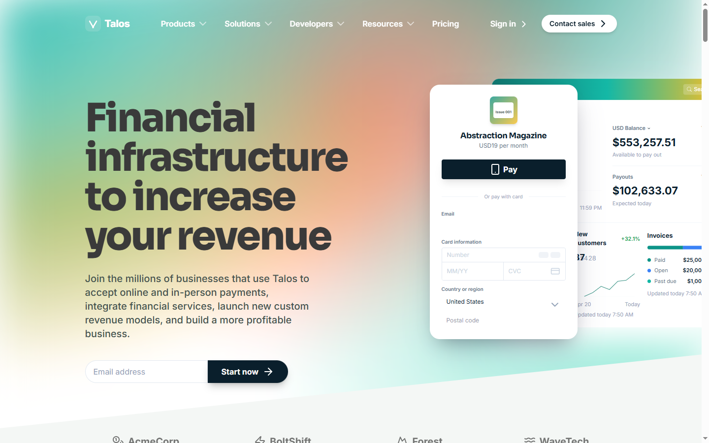

# Talos

A payments-infrastructure marketing site: one-page product story for a fictional financial platform, built with Next.js 14, TypeScript, Tailwind CSS and shadcn/ui primitives.



## What it is

A single marketing route (`/`) with eleven sections: hero, customer logos, product features, global scale, security, enterprise case studies, startup program, developer platform, no-code options, closing call to action and footer. It is a front-end demo: there is no backend, no real payments, no authentication and no CMS. Every form and link is a placeholder.

## Why this over a landing template

- **Own visual system.** Teal primary (`#0e7c6b`), amber accent (`#f2b84b`) and a deep ink (`#0a1f2c`), driven by theme tokens and the Tailwind scale rather than per-component palettes.
- **Two typefaces with one job each.** Sora for headings, Inter for body copy, both self-hosted at build time through `next/font`.
- **Fictional case studies only.** The four enterprise stories, their logos and the client logo row are invented brands, so no third-party trademark ships with the page.
- **Section-level components.** Each band of the page is an isolated component with its own copy, which makes swapping a section a one-file change.

## Quick start

Requirements: Node.js 18.17 or newer and npm.

```bash
git clone https://github.com/JORDANROBERTO74/talos-payments.git
cd talos-payments
npm install
npm run dev
```

Open <http://localhost:3000>.

| Command | What it does |
| --- | --- |
| `npm run dev` | Start the development server |
| `npm run build` | Create an optimized production build |
| `npm run start` | Serve the production build |
| `npm run lint` | Run ESLint |
| `npx tsc --noEmit` | Type check without emitting |

## Theming

`src/app/globals.css` holds the shadcn/ui CSS variables, the hero mesh gradient (`.refined-mesh`) and the heading font rule. `tailwind.config.ts` maps the brand colours (`primary`, `secondary`, `accent`, `brand-ink`, `brand-text`), radii and shadows.

To rebrand: change the hex values in `tailwind.config.ts`, the mesh stops in `globals.css`, the font pair in `src/app/layout.tsx`, then the wordmark in `src/components/brand-wordmark.tsx` and the icon in `src/app/icon.svg`. Hardcoded brand hexes still exist inside the section components, so a full palette swap is a find-and-replace across `src/components/landing`.

## Project structure

```text
src/
  app/                 App Router entry, metadata, global styles, icon
  components/
    brand-wordmark.tsx Wordmark and mark used by the nav and footer
    navigation.tsx     Sticky nav with mobile sheet
    landing/           One file per page section
    commons/           Payment-method marks and fictional client logos
    ui/                shadcn/ui primitives
  lib/                 Helpers and unused dashboard hooks
public/images/         Abstract case-study artwork
docs/                  README screenshots
```

## Deployment

Deployed on Vercel from the `main` branch; the production domain is assigned by the project name.

Live demo: <https://talos-payments.vercel.app>

## Status and scope

Verified with `npm run lint`, `npx tsc --noEmit`, `npm run build` and a visual pass at 1440 px and 390 px. Out of scope: real payment flows, analytics, forms, i18n, dark-mode polish beyond the token set, and the unused dashboard components under `src/components/ui`.

## License

MIT. See [LICENSE](LICENSE).
